# Stillhaven — Obsidian Theme

A warmer space for your notes. Stillhaven brings warm charcoal, soft cream,
and muted teal to Obsidian, with native typography and thoughtful details
for writing, navigating, and connecting ideas.


[](https://github.com/iM3SK/stillhaven-obsidian-theme/releases/latest)
[](manifest.json)
[](https://github.com/iM3SK/stillhaven-obsidian-theme/actions/workflows/quality.yml)
[](LICENSE)

[Download the latest release](https://github.com/iM3SK/stillhaven-obsidian-theme/releases/latest)
· [Release notes](CHANGELOG.md)
· [Report a bug](https://github.com/iM3SK/stillhaven-obsidian-theme/issues/new)

## Dark and light

### Warm charcoal

Cream text, a quiet active-file marker, softly tinted callouts, and distinct
task states give longer notes a clear rhythm.

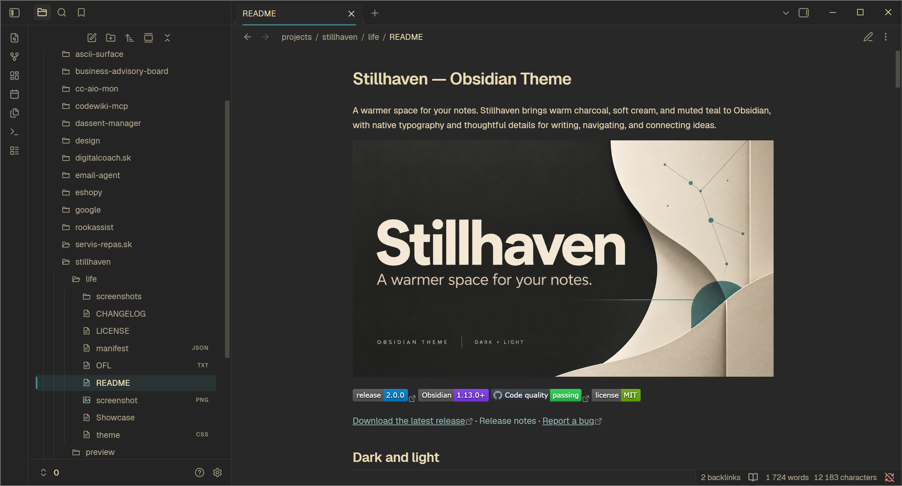

### Soft cream

A warm paper palette with teal accents, readable code, and the same note
structure in light mode.

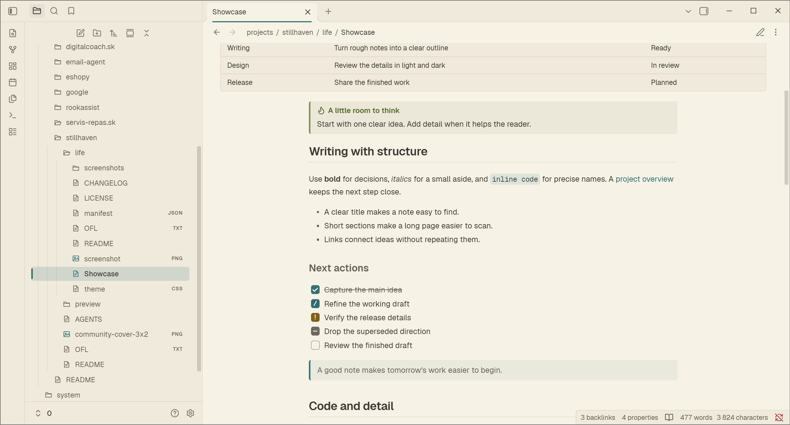

### Code, with room to read

In Reading View, a compact toolbar keeps the copy button above ordinary code
blocks. When editing code, Obsidian's native controls remain available. Neutral
surfaces match the surrounding note, while inline code has a clearer background.

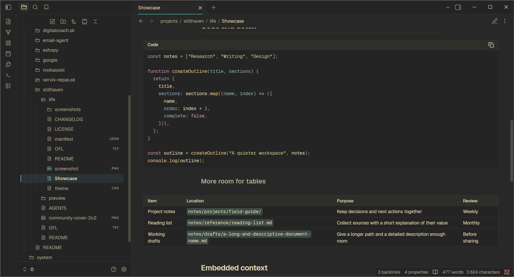

## Ideas, connected

Teal note nodes and clearer connections give Graph view a place in the palette.
Focused notes use a warm highlight; tags and attachments have distinct colors.
Your existing graph color groups remain available.

| Dark graph | Light graph |
| --- | --- |
| 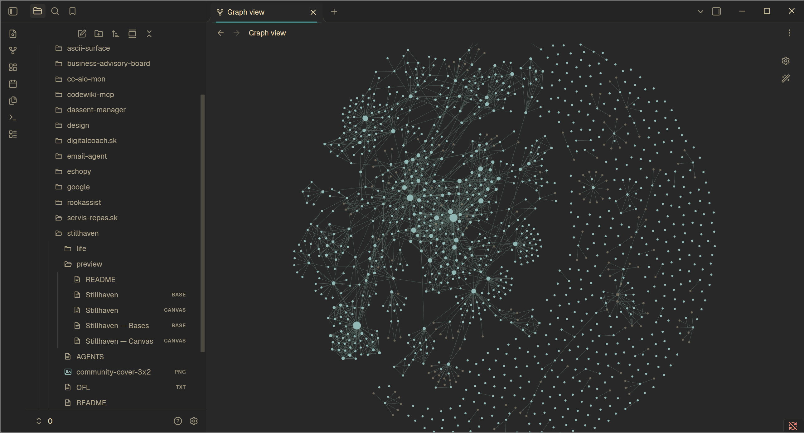 | 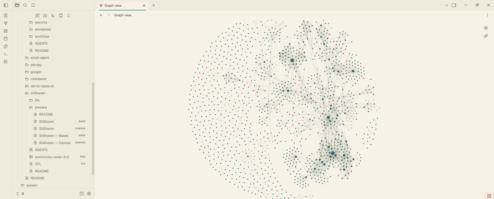 |

## Bases, in the same palette

Warm headers and summary rows keep tables close to the note's colors. Active
cells use a clear teal outline, and cards use softly rounded panel surfaces.

| Dark Bases | Light Bases |
| --- | --- |
| 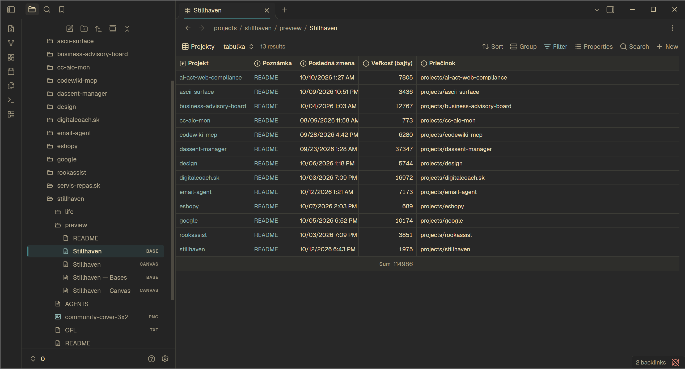 | 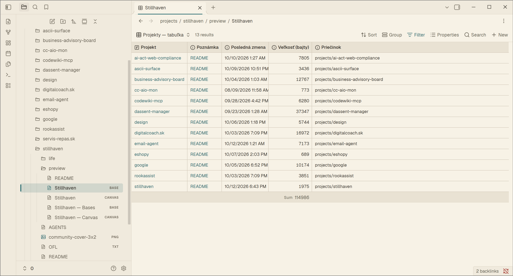 |

## Canvas, with room to connect

A warm dot grid, rounded cards, and quiet neutral connections bring Canvas
into the palette. Your colored cards and connections keep their own colors.

| Dark Canvas | Light Canvas |
| --- | --- |
| 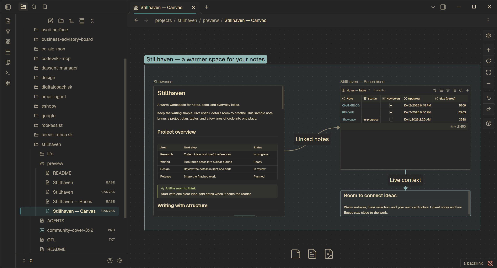 | 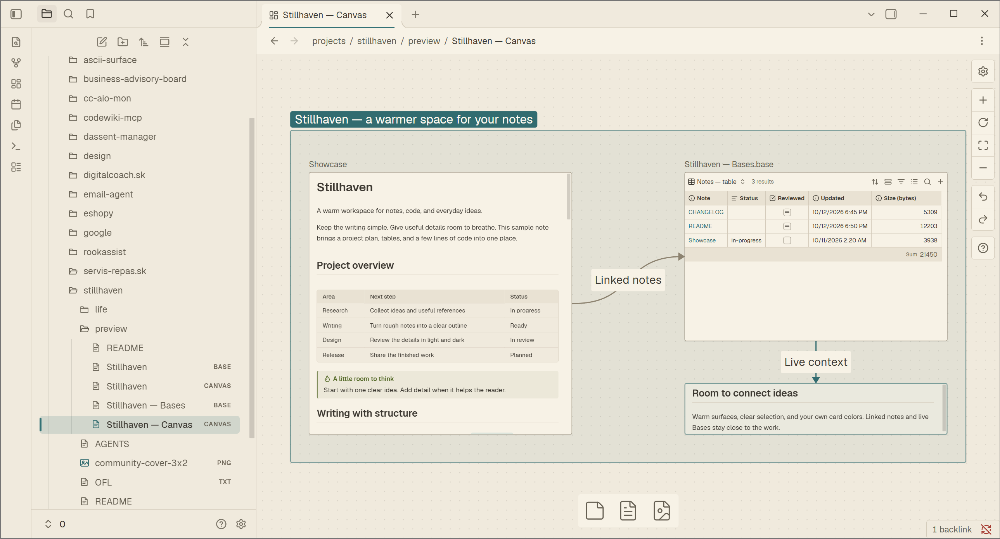 |

## Clear commands

The command palette keeps selections visible in both color modes.

| Dark command palette | Light command palette |
| --- | --- |
| 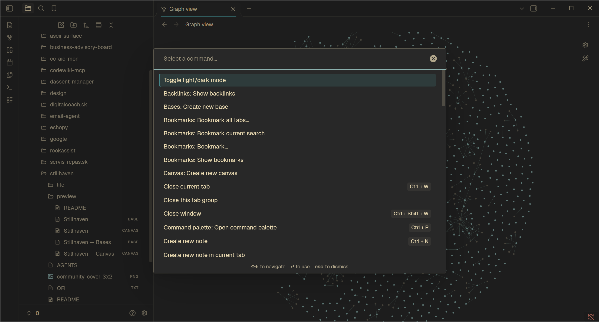 | 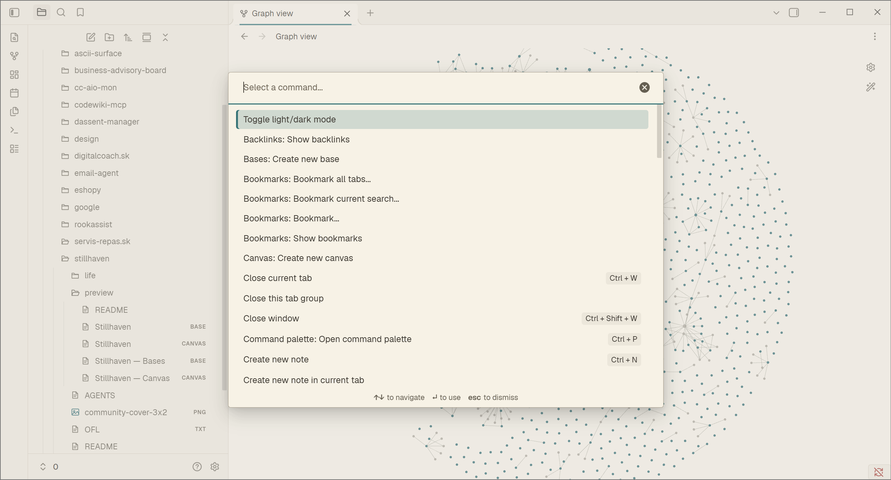 |

## Details for everyday notes

| Detail | What it brings |
| --- | --- |
| Typography | Your Obsidian fonts, with comfortable spacing for prose, code, and tables; Geist and Geist Mono are optional recommendations. |
| Tables and code | Compact, rounded surfaces in neutral colors, clearer inline code, and a separate copy toolbar above rendered code blocks. |
| Navigation | Built-in folder and file icons, a slim active-file marker, and clear search and command selections. Icons stay hidden while renaming. |
| Structure | A quiet Properties panel, a thin rule under H2, quieter H3 headings, and compact, softly tinted callouts with a slim accent edge. |
| Tasks | Centered vector symbols for incomplete `[/]`, important `[!]`, and canceled `[-]` items in Reading View and Live Preview, independent of your font. |
| Embedded context | Compact inset note embeds with their source links and editing controls, plus optional image galleries in Reading View. |
| Bases | Warm table headers and summary rows, accented active cells, and rounded cards in the note's panel colors. |
| Canvas | A warm backdrop and dot grid, clearer card labels, rounded cards, and neutral borders and connections that fit the palette. |
| Controls | Visible keyboard focus and readable destructive confirmation buttons in both color modes. |

## Install

In Obsidian, open **Settings → Appearance → Themes → Manage**, search for
**Stillhaven**, and select **Install and use**. The theme is also listed in the
[Obsidian Community directory](https://community.obsidian.md/themes/stillhaven).

To update Stillhaven, open **Settings → Appearance → Themes → Manage**, select
**Stillhaven**, and choose **Check for updates**. If an update is available,
select **Update** to install it.

### Manual installation

Download these four release assets:

- [theme.css](https://github.com/iM3SK/stillhaven-obsidian-theme/releases/latest/download/theme.css)
- [manifest.json](https://github.com/iM3SK/stillhaven-obsidian-theme/releases/latest/download/manifest.json)
- [OFL.txt](https://github.com/iM3SK/stillhaven-obsidian-theme/releases/latest/download/OFL.txt)
- [LICENSE](https://github.com/iM3SK/stillhaven-obsidian-theme/releases/latest/download/LICENSE)

1. Open your vault folder and find its Obsidian configuration folder
   (normally `.obsidian`).
2. Create a `Stillhaven` folder inside `themes`.
3. Copy the downloaded files into that folder.
4. In Obsidian, open **Settings → Appearance** and select **Stillhaven**.
5. Choose the light or dark base color scheme in the same settings page.

The manifest requires Obsidian 1.13.0 or later. No community plugin or separate
font installation is required.

To update a manual installation, replace those files with the assets from the
latest release and reload Obsidian.

## Optional fonts

Stillhaven uses Obsidian's default fonts and respects your font choices. No
fonts are embedded in the theme, downloaded by it, or required to use it.

If you prefer the typography bundled through 1.7.0, optionally install **Geist**
and **Geist Mono** from [Vercel's official font page](https://vercel.com/font).
Choose the desktop font files in the download and install them using your
operating system's font installer. Reopen Obsidian if the fonts do not appear.

In **Settings → Appearance**, set:

- **Interface font** to `Geist`.
- **Text font** to `Geist`.
- **Monospace font** to `Geist Mono`.

When upgrading from 1.7.0 or earlier, this optional setup restores the intended
font families. Without it, text width and line wrapping can differ from
screenshots of 1.7.0 and earlier, which used the previously embedded fonts.

## Corners

Stillhaven uses one corner token, `--stillhaven-radius`, with a default of
`4px`. Tables, code blocks, callouts, cards, and native control corner variables
all refer to it. To change the rounding, enable a CSS snippet such as:

```css
body {
  --stillhaven-radius: 4px;
}
```

Callouts and note embeds share compact padding, paragraph spacing, and line
height. Embedded headings use smaller sizes to keep excerpts close to the
surrounding note.

## Sample note

[Showcase.md](Showcase.md) is a synthetic sample note for previewing Properties,
task states, note embeds, image galleries, typography, tables, code, and callouts.
Copy it into your vault together with
[appearance-dark.png](screenshots/appearance-dark.png) and
[appearance-light.png](screenshots/appearance-light.png), keeping both images
inside a `screenshots` folder. Keep the sample's filename so its embedded
Typography section resolves.

## Task states

Write the marker directly in a Markdown task:

```markdown
- [/] Work in progress
- [!] Important detail
- [-] Canceled direction
```

These markers change the appearance in Reading View and Live Preview. Obsidian
treats every non-empty marker as checked; clicking it clears the checkbox. To
choose another custom state, edit the character between the brackets.
Their vector symbols share the native checkmark's bounds and stay centered
when you change fonts.

## Optional image gallery

Put images inside Stillhaven's custom `gallery` callout:

```markdown
> [!gallery] Reference images
> ![[first-image.png]]
> ![[second-image.png]]
```

Use your own image filenames. Consecutive image lines and images separated by
blank quoted lines both work. Place descriptions before or after the callout;
its content should contain only images. In Reading View, images stay in source
order, filling each row from left to right, and use one to four columns according
to the gallery's available width. Their proportions are preserved. Live Preview,
Canvas, and print/PDF keep the regular image layout. No plugin is needed.

## Feedback

For layout or styling problems, [open an issue](https://github.com/iM3SK/stillhaven-obsidian-theme/issues/new).
Include the theme and Obsidian versions, your operating system, the light or
dark mode, and steps to reproduce the issue.
If CSS snippets or community plugins are active, check whether the problem also
occurs with them disabled and include that result.

For an improvement suggestion, explain the note-taking task it would help.

## Compatibility

Stillhaven styles Obsidian's native interface and controls. CSS snippets and
community plugins can affect its appearance.

The theme requires Obsidian 1.13.0 or later. Its desktop appearance was checked
in Obsidian 1.14.4. Mobile layouts and the minimum declared version have not
been separately verified. Screenshots show Stillhaven 2.0.0 with native fonts.

[Code quality](https://github.com/iM3SK/stillhaven-obsidian-theme/actions/workflows/quality.yml)
checks CSS, the theme manifest, license notices, and Markdown.

## License

Stillhaven's theme code and documentation are licensed under the
[MIT License](LICENSE), copyright (c) 2026 iM3SK.
The optional **Geist** and **Geist Mono** fonts are licensed separately under
the [SIL Open Font License](OFL.txt). They are not bundled with Stillhaven 2.0.0;
the theme's MIT license does not replace their license.

## Project files

- [theme.css](theme.css) contains the styles and embedded icon assets.
- [manifest.json](manifest.json) contains the theme name, version, and author.
- [LICENSE](LICENSE) contains the MIT license for the theme code and documentation.
- [OFL.txt](OFL.txt) contains the license for the recommended Geist fonts.
- [Showcase.md](Showcase.md) contains the sample note.
- [CHANGELOG.md](CHANGELOG.md) contains release notes.

Created by [iM3SK](https://github.com/iM3SK).
